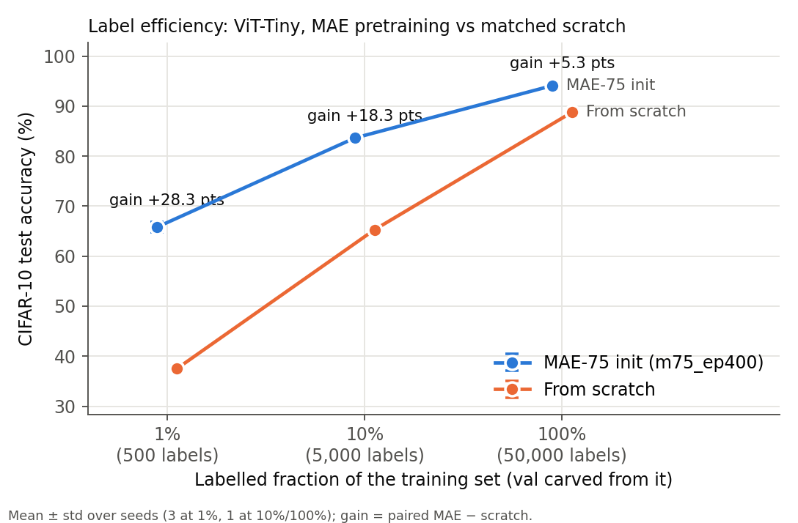
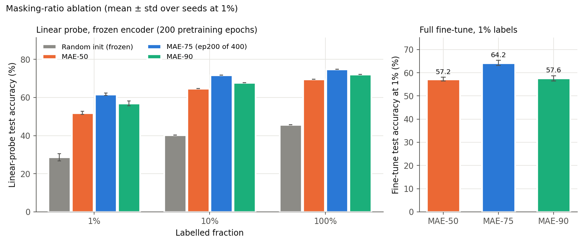
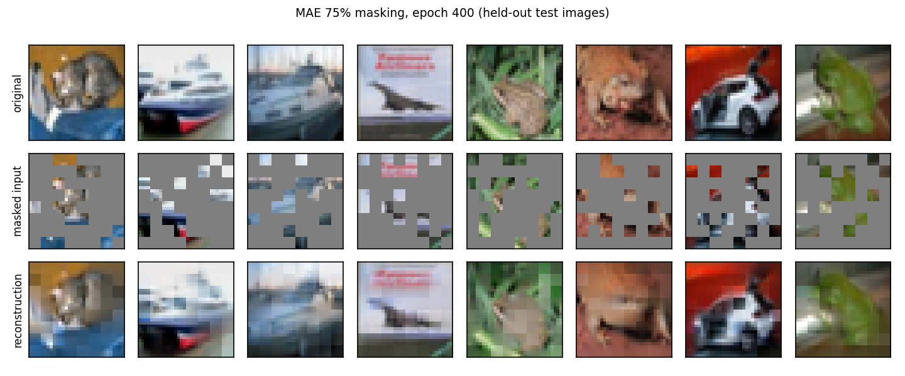

# MAE for label-efficient vision (CIFAR-10, ViT-Tiny, from scratch)

A Masked Autoencoder written from scratch in PyTorch, pretrained on the 50K CIFAR-10 training
images **without labels**, then used to measure how many labels a ViT-Tiny needs compared with a
from-scratch baseline trained under exactly the same recipe. Design rationale:
[`docs/design_doc_v1.0.md`](docs/design_doc_v1.0.md).

## Result

Pretraining a from-scratch ViT-Tiny MAE (75% masking, 400 epochs) on the 50K unlabelled CIFAR-10
training images raises test accuracy from **37.5 ± 0.6% to 65.8 ± 1.0% with 1% labels** (500
images; **+28.3 ± 1.3 points**, paired over 3 seeds), from **65.3% to 83.6% with 10%** (+18.3) and
from **88.8% to 94.1% with 100%** (+5.3). The baseline is a from-scratch model with the same
subsets, augmentation and step budget, and its own LR sweep. As hypothesised, the gain shrinks as
labels grow. MAE never hurt, but at 100% labels its advantage is small and measured on a single
seed. Doubling the 10% budget to 12,000 steps moved scratch only from 65.3% to 65.7% (and MAE from
83.6% to 82.3%), so the baseline is not undertrained. In the masking-ratio ablation (200
pretraining epochs each), **75% beats 50% and 90% on every metric**: linear probe 61.7 vs 51.9 / 56.9%
at 1% labels and 74.9 vs 69.6 / 72.1% at 100%, and 1% fine-tuning 64.2 vs 57.2 / 57.6%. Every MAE
encoder sits far above the random-init frozen floor (28.7% probe at 1% labels, 45.8% at 100%); the
main 400-epoch encoder reaches 78.2%, **+32.4 points over that floor**.

**Where MAE did not help, and other caveats.**
- Longer fine-tuning did not help MAE: 12,000 steps at 10% gave 82.3% vs 83.6% at 6,000.
- At 10% labels the 400-epoch encoder's probe (71.2%) is no better than the 200-epoch one (71.7%).
  That comparison is one seed, with the LR picked on 500 val images.
- 10% and 100% are single-seed, so those gains have no error bars.
- The 75% row of the ablation is the epoch-200 checkpoint of the 400-epoch run, whose cosine LR had
  not finished annealing. If anything, that handicaps 75%.
- At 1% labels, validation sets are 100 images, so LR choices there are noisy.



**Label efficiency** (full fine-tuning, CIFAR-10 test accuracy %):

| Label fraction | Labelled images | MAE-75 fine-tune | Scratch | Paired gain (pts) | LR (MAE / scratch) | Seeds |
| --- | --- | --- | --- | --- | --- | --- |
| 1% | 500 | 65.8 ± 1.0 | 37.5 ± 0.6 | +28.3 ± 1.3 | 5e-4 / 5e-4 | 3 |
| 10% | 5,000 | 83.6 | 65.3 | +18.3 | 1e-3 / 1e-3 | 1 |
| 100% | 50,000 | 94.1 | 88.8 | +5.3 | 1e-3 / 1e-3 | 1 |



**Masking-ratio ablation** (test accuracy %; probe LR chosen on val per subset; fine-tune at the LR
MAE-75 chose at 1%):

| Encoder | Probe 1% | Probe 10% | Probe 100% | Fine-tune 1% |
| --- | --- | --- | --- | --- |
| Random init (frozen) | 28.7 ± 1.9 | 40.3 | 45.8 | - |
| MAE-50, 200 ep | 51.9 ± 0.8 | 64.6 | 69.6 | 57.2 ± 0.8 |
| **MAE-75, 200 ep** (epoch 200 of the 400-ep run) | **61.7 ± 0.7** | **71.7** | **74.9** | **64.2 ± 1.1** |
| MAE-90, 200 ep | 56.9 ± 1.3 | 67.7 | 72.1 | 57.6 ± 1.1 |
| MAE-75, 400 ep (main model) | 66.9 ± 0.1 | 71.2 | 78.2 | see table above |



| Other evidence | File |
| --- | --- |
| Validation curves for both arms (is the scratch baseline plateaued?) | `results/figures/val_curves.png` |
| Reconstruction grids for 50 / 75 / 90% masking | `results/figures/recon_m{50,75,90}.png` |
| Every run (109: 3 pretrains, 31 fine-tunes, 75 probes) | `results/runs.csv`, per-run curves in `results/logs/` |
| 10% longer-budget check (12,000 steps) | `results/extra/longcheck/runs.csv` |
| Epoch-100 gate: probe at 100% labels, random 45.8% vs MAE-75@ep100 70.0% | `results/extra/gate_ep100/runs.csv` |
| Encoder vs decoder parameters and compute | `results/tables/model_stats.md` |

Pretraining loss (masked patches, normalised pixels): 1.32 at epoch 1, 0.353 at epoch 100,
**0.321 at epoch 400** for MAE-75; 0.186 for MAE-50 and 0.529 for MAE-90 at 200 epochs. Lower is not
better across ratios: a lower ratio is simply an easier task.

Compute: MAE-75 pretraining took 71 min on one Kaggle T4 (9.2 s/epoch), and the whole run matrix
used about 7.5 T4-hours across four Kaggle sessions.

## CV bullet → evidence

| CV bullet | Evidence in this repo |
| --- | --- |
| 1. MAE from scratch: ViT encoder–decoder, 75% masking, loss on masked patches only | `src/mae/vit.py`, `src/mae/mae.py` (no timm/HF/`nn.MultiheadAttention`); `tests/test_masking.py`, `tests/test_loss.py` (changing visible-patch targets leaves the loss unchanged; zero gradient from visible predictions); `results/figures/recon_m75.png` |
| 2. ViT-Tiny pretrained on 50K unlabelled images, fine-tuned at 1/10/100% vs matched scratch | `results/figures/label_efficiency.png`, `results/tables/label_efficiency.md`, `results/runs.csv`; matching enforced in `src/mae/engine.py::finetune_run` |
| 3. Shallow decoder so semantic capacity sits in the encoder | [Architecture](#architecture-and-the-shallow-decoder-bullet-3) below, `scripts/model_stats.py`; decoder never leaves pretraining (only `encoder_*.pt` is saved for downstream use) |
| 4. Masking-ratio ablation 50/75/90 + linear probe vs random-init frozen encoder | `results/figures/ablation.png`, `results/tables/ablation.md` |

## Architecture and the shallow decoder (bullet 3)

| Component | Setting |
| --- | --- |
| Patches | 4×4 px → 64 tokens of 48 values; fixed 2D sin-cos position embedding |
| Encoder | ViT-Tiny: 12 pre-norm blocks, width 192, 3 heads, MLP 768, final LayerNorm, no class token |
| Masking | per image: uniform noise → argsort → keep first 16 of 64 (75%); encoder sees only these |
| Decoder | 192→128, mask tokens, unshuffle, pos-embed, 4 blocks × width 128 (4 heads), 128→48 |
| Loss | MSE on per-patch-normalised pixels, **masked patches only** |
| Classifier | encoder on all 64 tokens → mean-pool → LayerNorm → Linear(192, 10), same for both arms |

Measured by `python scripts/model_stats.py` (torch FLOP counter, per image):

| Part | Parameters | Compute per image | Share of pretraining compute |
| --- | --- | --- | --- |
| Encoder (16 visible tokens) | 5.35 M | 87 M MACs | 61% |
| Decoder (64 tokens) | 0.82 M | 55 M MACs | 39% |
| Encoder at fine-tune (64 tokens) | 5.35 M | 359 M MACs | n/a |

The decoder has 15% of the encoder's parameters, and dropping masked tokens makes the encoder
4.1× cheaper during pretraining. The decoder is discarded after pretraining, and everything it knows
about an image has to pass through the encoder's 16 visible-token outputs, so the understanding has
to live in the encoder. The caveat (MAE paper): a 1-block decoder makes the last encoder blocks
specialise in pixels, which hurts linear probing. So the decoder here has 4 blocks: shallow relative
to the 12-block encoder, but not minimal.

## Reproduce

Everything runs from scripts. The Kaggle notebooks only fetch the code and call `scripts/run_block.sh`.

```bash
pip install -r requirements.txt
python scripts/make_splits.py --data ./data      # only if you want to regenerate; splits/ is committed
MAE_DATA=./data python -m pytest -q tests       # 26 tests; one-batch overfit ~3 min on CPU (skips without CIFAR)
bash scripts/smoke_test.sh ./data                # whole pipeline in miniature (numbers meaningless)
bash scripts/run_block.sh <block> [...]          # the real run matrix, one block per session
```

### Run plan on a Kaggle T4

Upload this repo as a Kaggle Dataset (or push to GitHub and set `REPO_URL` in the notebook). Turn on
**GPU T4** and **Internet** (for the CIFAR-10 download). Use **Save & Run All** for long blocks.
Attach each session's output as an input to the next one: checkpoints and earlier `runs.csv` files are
found and merged automatically, so LR choices carry across sessions.

| # | Notebook | `BLOCKS` | What it does | Gate before moving on |
| --- | --- | --- | --- | --- |
| 1 | `kaggle_pretrain` | `test timing lrcheck` | tests + smoke pipeline on GPU, 5-epoch timing, 20-epoch LR check (3e-4 vs 1e-3) | all tests pass; set `LR_PT=1e-3` only if it has lower loss |
| 2 | `kaggle_pretrain` | `pretrain_m75` | MAE-75, 400 epochs (encoders saved every 50 epochs) | recon grids look plausible |
| 3 | `kaggle_finetune` | `probe_ep100` | epoch-100 encoder probe vs random init | MAE clearly above random |
| 4 | `kaggle_finetune` | `ft_low` | 1% + 10% LR sweeps (both arms, seed 0), 1% seeds 1–2 at chosen LRs | |
| 5 | `kaggle_pretrain` | `pretrain_abl` (+ `pretrain_m75e200`, optional) | MAE-50 and MAE-90, 200 epochs | |
| 6 | `kaggle_finetune` | `ft_100` | 100% LR sweeps (both arms) | scratch val curve plateaued |
| 7 | `kaggle_finetune` | `ft_ablation probes figures` | ablation fine-tunes, all linear probes, figures + tables | every run in `runs.csv` |

Then download `results/` into this repo, and if you have several sessions' CSVs, run
`python scripts/merge_runs.py --out results/runs.csv <csvs...>` and
`python scripts/make_figures.py`.

### Protocol (what makes "matched" defensible)

* **Splits** are class-balanced and committed (`splits/frac{1,10,100}_seed*.json`). Validation is
  carved from the labelled fraction (1% = 400 train + 100 val), and both arms load the same files.
* **Fine-tuning** is the same for both arms: AdamW (0.9, 0.999), wd 0.05, 5% warm-up + cosine,
  stochastic depth 0.1, label smoothing 0.1, RandAugment(2, 9), fp16, the same step budget
  (3000 / 6000 / 17600 steps at batch 64 / 128 / 256) and **its own** LR sweep {5e-4, 1e-3, 2e-3}
  on seed 0. Layer-wise LR decay is deliberately left out, because it would make the arms differ in
  two things instead of one.
* **Selection**: the best-val checkpoint is tested once on the 10K test set. LRs are chosen on val,
  never on test. Reported as mean ± std over seeds (3 at 1%, 1 at 10% and 100%) plus the paired gain.
* **Linear probe**: frozen encoder on all 64 tokens, mean-pooled, cached; BatchNorm (no affine) +
  Linear, AdamW, 100 epochs, LR {1e-3, 1e-2, 1e-1} chosen on val per subset. The random-init frozen
  encoder is the floor.

## Deviations from design doc v1.0 (and why)

1. **Ablation fine-tune adds MAE-75@200 at 1% (3 runs).** The doc's run matrix lists only
   MAE-50/90 there. Without the matching MAE-75 runs, the fine-tune column would compare 200-epoch
   encoders with a 400-epoch one.
2. **`pretrain_m75e200` was not run.** The epoch-200 checkpoint of the 400-epoch run is mid-cosine
   (its LR has not annealed), while MAE-50/90 finish their own 200-epoch schedules. So the ablation
   compares equal epochs, not equal schedules, which slightly favours 50/90; 75% won anyway. The
   optional block is still there if you want the fully matched row.
3. **LR check uses 2 warm-up epochs.** With the main recipe's 20, a 20-epoch check would be pure warm-up.
4. **Pretraining augmentation runs on the GPU.** RandomResizedCrop(0.2–1.0) + flip are implemented as one
   batched affine `grid_sample` (bilinear) over the uint8 dataset kept on the GPU, so a T4 isn't bottlenecked
   on Kaggle's 4 CPU cores. Fine-tuning keeps torchvision RandAugment in DataLoader workers.
5. **Overfit test** uses a fixed mask, 64 real CIFAR images and 500 steps, and asserts a >10× loss drop
   (it skips if CIFAR isn't on disk; the `test` block downloads it first). Noise or synthetic images
   plateau near the mean and say nothing about wiring.
6. **Checkpointing**: the full resumable state (`ckpt_latest.pt`) is overwritten every 25 epochs, and
   encoder-only weights are kept every 50 epochs (ep100 for the gate, ep200 for the ablation, ep400 main).
7. **Pretraining LR is 1e-3, not 3e-4.** The 20-epoch LR check (the doc's guard) gave a lower
   reconstruction loss at 1e-3 (0.43 by epoch 12 vs 0.47 after 20 epochs at 3e-4), so every pretrain
   ran at 1e-3, and the pretrain configs now set `lr: 1.0e-3` so a plain rerun reproduces it.
8. **Added a 10% longer-budget check**: both arms at 12,000 instead of 6,000 steps, to answer
   "was the baseline undertrained?" (`results/extra/longcheck/`). It is kept out of the main tables.
9. **Extra files** beyond the doc's layout: `src/mae/engine.py` (training loops, shared by scripts and tests),
   `scripts/run_block.sh` (the run matrix), `smoke_test.sh`, `merge_runs.py`, `model_stats.py`,
   `tests/test_splits.py` (also checks that `--set lr=1e-3` parses as a number; plain PyYAML reads it as a string).

**Reconstruction grids:** the model predicts *normalised* pixels, so to draw a masked patch, its prediction
is rescaled with that patch's true mean and std. Brightness and colour cast in masked patches therefore come
from the original, and only the structure comes from the model.

## Layout

```
configs/    pretrain_m{50,75,90}.yaml, pretrain_m75_e200.yaml (optional), finetune.yaml, probe.yaml
splits/     committed label subsets
src/mae/    pos_embed.py, vit.py, mae.py, data.py, engine.py, utils.py
scripts/    make_splits, pretrain, finetune, probe, make_figures, merge_runs, model_stats, run_block.sh, smoke_test.sh
tests/      test_shapes, test_masking, test_loss, test_resume, test_splits
notebooks/  kaggle_pretrain.ipynb, kaggle_finetune.ipynb (thin wrappers)
results/    runs.csv, logs/, figures/, tables/
```

Reproducibility: seeds for Python, NumPy and torch come from the config; every `runs.csv` row records the
git commit. `cudnn.benchmark` is on, so GPU runs are not bit-exact, and seed variance is reported instead.
CPU resume is bit-exact (`tests/test_resume.py`).

## References

He et al., *Masked Autoencoders Are Scalable Vision Learners*, CVPR 2022 ·
Dosovitskiy et al., *An Image is Worth 16x16 Words*, ICLR 2021 ·
Touvron et al., *Training data-efficient image transformers* (DeiT), ICML 2021.
